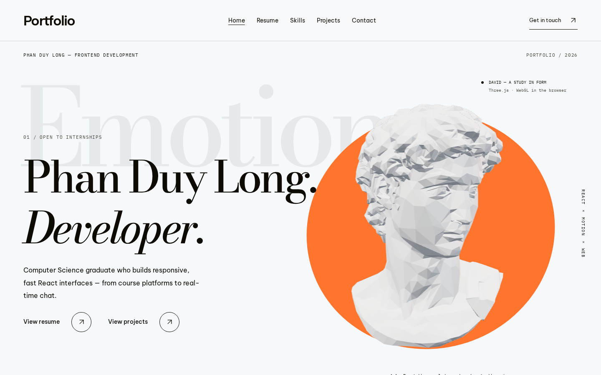
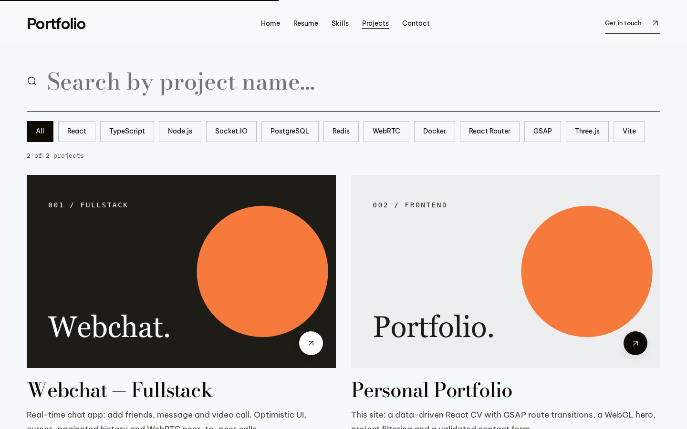
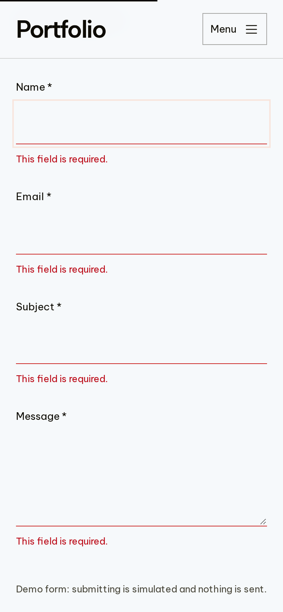

# Phan Duy Long — CV Portfolio

Website CV cá nhân nhiều trang, xây dựng bằng React và React Router. Gồm các trang: giới thiệu, hồ sơ, kỹ năng, danh sách dự án có lọc và tìm kiếm, và form liên hệ có validate. Chuyển trang có hiệu ứng động, trang chủ có tượng 3D WebGL.

**Link demo:** _đang cập nhật_



| Dự án — lọc & tìm kiếm | Liên hệ — validate (mobile) |
| --- | --- |
|  |  |

## Tech stack

- **React 19** + **Vite 6**
- **React Router 7**: routing phía client (`BrowserRouter`, `NavLink`)
- **GSAP 3** (+ ScrollTrigger): hiệu ứng chuyển trang và hiệu ứng khi cuộn
- **Three.js**: tượng 3D ở trang chủ, tải lazy thành chunk riêng
- **CSS thuần** với design token (CSS custom properties), không dùng UI framework
- **ESLint 10** (flat config, `react-hooks` + `react-refresh`)

## Cách chạy dự án

Yêu cầu Node.js 20.19+ (hoặc 22.13+).

```bash
npm install
npm run dev       # chạy dev server tại http://localhost:5173
npm run build     # build production vào thư mục dist/
npm run preview   # chạy thử bản build
npm run lint      # kiểm tra code bằng ESLint
```

Khi deploy lên hosting tĩnh, mọi route phải fallback về `index.html` để mở thẳng `/projects` hay reload trang không bị 404. Dự án đã có sẵn cấu hình này:

- `vercel.json` cho Vercel.
- `public/_redirects` cho Netlify và Cloudflare Pages.

## Tính năng đã làm

### Routing

- Có các route `/` (Trang chủ), `/resume`, `/skills`, `/projects`, `/contact`, và trang **404** cho mọi đường dẫn không tồn tại.
- Navbar tô sáng link của trang hiện tại (`NavLink` + `aria-current="page"`).
- Khi chuyển trang, trang mới bắt đầu từ đầu trang.
- Khi bấm Back/Forward, trang khôi phục lại vị trí cuộn cũ. Link có `#hash` cuộn đến đúng mục.
- Mỗi trang có `<title>` và meta description riêng.

### Hiệu ứng chuyển trang (2 kiểu, dùng GSAP)

- **Curtain:** khi vào hoặc rời Trang chủ, một tấm màn kéo lên che trang, hiện tên trang đích, rồi kéo đi.
- **Blur-slide:** khi chuyển giữa các trang con, trang cũ mờ dần và trượt ra, trang mới trượt vào.
- Hiệu ứng áp dụng cho mọi cách điều hướng: navbar, nút CTA, và nút Back/Forward của trình duyệt.
- Click liên tục hoặc ngắt giữa chừng vẫn ổn: luôn dừng ở trang được chọn cuối cùng, và hai trang không bao giờ chồng lên nhau.
- Tôn trọng `prefers-reduced-motion`: khi bật, trang đổi ngay, không có animation.
- Sau khi chuyển trang, focus chuyển vào `<main>` của trang mới, giúp người dùng bàn phím và trình đọc màn hình.

### Các trang

- **Trang chủ:**
  - Hero ghi họ tên, chức danh ứng tuyển và đoạn giới thiệu ngắn.
  - Nút CTA "View resume" và "View projects".
  - Tượng David 3D tải lazy: kéo chuột hoặc dùng phím mũi tên để xoay, có nút tạm dừng chuyển động.
  - Các phần: lĩnh vực chính, giới thiệu, dự án tiêu biểu, lời mời liên hệ.
- **Hồ sơ (Resume):**
  - Thông tin cá nhân và mục tiêu nghề nghiệp.
  - Học vấn: trường, chuyên ngành, GPA, thời gian học.
  - Kinh nghiệm làm việc dạng timeline: công ty, vị trí, thời gian, mô tả theo bullet.
  - Nút **Download CV** để tải file PDF.
- **Kỹ năng (Skills):**
  - Kỹ năng kỹ thuật chia theo nhóm (Language, Frontend, Backend, Tools).
  - Mỗi kỹ năng có thanh mức độ 3 bậc (`role="meter"`).
  - Kỹ năng mềm và ngoại ngữ.
- **Dự án (Projects):**
  - Dữ liệu lấy từ `src/data/projects.js` và render bằng `.map()`.
  - **Tìm kiếm** theo tên dự án (không phân biệt hoa thường hay dấu tiếng Việt), kết hợp được với **lọc theo tag công nghệ**.
  - Hiện số kết quả. Khi không có kết quả thì hiện thông báo kèm nút "Clear filters".
  - Mỗi card có thumbnail, tên, mô tả, điểm nổi bật, công nghệ, link GitHub và link Demo.
  - Dự án chưa có demo: nút Demo bị vô hiệu hoá (`aria-disabled`) và hiện tooltip "Not deployed yet" khi hover hoặc focus bằng bàn phím.
- **Liên hệ (Contact):** form gồm name, email, subject và message.
  - Validate: bắt buộc nhập mọi trường, email đúng định dạng, message tối thiểu 20 ký tự.
  - Lỗi hiện riêng dưới từng trường (khi rời trường hoặc khi submit) và được gắn vào input qua `aria-describedby`. Khi submit lỗi, focus nhảy đến trường sai đầu tiên.
  - Khi đang gửi, nút bị vô hiệu hoá và hiện spinner. Việc gửi được giả lập bằng `setTimeout` 1,5 giây, sau đó hiện thông báo thành công. Không dùng `alert()`.
  - Trang cũng hiện các kênh liên hệ khác: Email, SĐT, LinkedIn, GitHub.
- **404:** thông báo lỗi kèm link quay lại tất cả các trang.

### Micro-interactions

- Các section hiện dần khi cuộn tới, có thanh tiến trình đọc ở đầu trang.
- Card dự án có cùng hiệu ứng hover ở Trang chủ và trang Dự án: ảnh phóng to, nút tròn bám theo con trỏ, tiêu đề hiện dần từng chữ.
- Thanh kỹ năng có hiệu ứng chạy lên.

### Responsive

- Bố cục được chỉnh riêng cho mobile (**< 768px**), tablet (**768–1024px**) và desktop (**> 1024px**). Không bị tràn ngang ở bất kỳ độ rộng nào.
- Trên mobile, navbar thu gọn thành nút menu (hamburger).

### Accessibility

- Dùng thẻ ngữ nghĩa: `header`, `nav`, `main`, `section`, `article`, `footer`. Mỗi trang có đúng một `h1`, kèm link "Skip to content".
- Mọi ảnh đều có `alt`. Ảnh chỉ để trang trí thì được ẩn khỏi trình đọc màn hình.
- Menu mobile dùng được hoàn toàn bằng bàn phím:
  - Enter/Space để mở hoặc đóng, Escape để đóng. Menu cũng tự đóng khi click ra ngoài hoặc sau khi chuyển trang.
  - Nút menu có `aria-expanded` và `aria-controls`.
- Focus outline hiển thị rõ. Mọi trường trong form đều có `<label htmlFor>`.

### Hiệu năng

- Three.js và model 3D chỉ tải khi vào trang chủ, nằm trong chunk riêng.
- Ảnh được lazy-load (`loading="lazy"`).
- CSS của mỗi trang được gắn và gỡ cùng với trang đó, nên không xung đột giữa các trang.

## Cấu trúc thư mục

```
src/
  App.jsx                 khai báo route, wrapper chuyển trang, quản lý scroll
  components/             Header, Footer, PageShell, ProjectCard, SkillBar, TimelineEntry…
  data/                   profile, resume, skills, projects, navigation (toàn bộ nội dung)
  hooks/                  useRouteTransition, useProjectFilter, useContactForm, useInnerPageMotion
  i18n/                   I18nProvider + en.js (toàn bộ chữ trên giao diện, sẵn sàng thêm ngôn ngữ)
  lib/                    helper dùng chung cho hiệu ứng chữ và nút "nam châm"
  pages/                  Home, Resume, Skills, Projects, Contact, NotFound
    home/                 lớp hiệu ứng của trang chủ (GSAP) và tượng 3D tải lazy
  styles/                 font, hiệu ứng chuyển trang, CSS theo từng trang
public/
  cv/                     file CV (PDF) để tải về
  _redirects              fallback SPA cho Netlify / Cloudflare Pages
vercel.json               fallback SPA cho Vercel
```

Toàn bộ chữ trên giao diện nằm trong `src/i18n/en.js`. Trong các file dữ liệu, nội dung chữ nằm dưới khóa `content.en`. Muốn thêm ngôn ngữ, chỉ cần thêm một file từ điển và các mục `content.<locale>` tương ứng.

## Credits

- Model 3D: *Head of Michelangelo's David (optimised)* của Thomas Flynn, giấy phép CC BY 4.0, dựa trên bản scan tượng của SMK (CC0).
